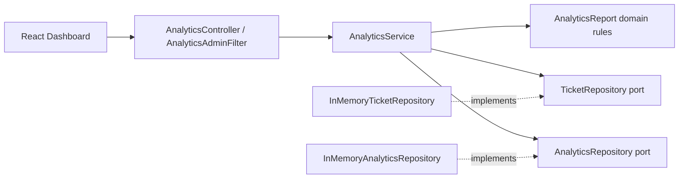

ServiceTicketPortal:

To run Service ticket portal, run CT5106-project folder in powershell, then use: 
.\mvnw.cmd spring-boot:run

If port 8080 is in use, run:
.\mvnw.cmd spring-boot:run "-Dspring-boot.run.arguments=--server.port=8081"

RepairTicketTest tests info:
openingATicketStartsItAsOpen checks that a new ticket with a description starts as OPEN.
aBlankDescriptionIsRefused checks that blank descriptions are rejected and a ticket isnt made.
anOpenTicketCannotBeClosed checks that closing an open ticket fails, the error is “A ticket has to be resolved before it can be closed”, and the ticket stays OPEN.
aResolvedTicketCanBeClosed checks that resolving a ticket and then closing it leaves it status as CLOSED.

to run these tests use:
.\mvnw.cmd test

## Assignment 2: Service Analytics (Senlei Liu, User Story 1.2.3 / 2.3)

Assignment 2 requires a partial backend user story per member, with domain logic flowing
through Clean Architecture layers. In-memory repositories are sufficient at this stage.
The analytics prototype reads the portal's existing repair tickets, calculates status counts,
outstanding tasks and feature usage, and stores the latest report in memory.

### Setup and demo

Prerequisites: Java 17 or later, and Node.js 20.19+ or 22.12+ with npm.

Set temporary local demo credentials before starting Spring Boot. Choose your own password;
do not commit it. Spring Boot maps these environment variables to
`bms.analytics.admin.username` and `bms.analytics.admin.password`.

macOS/Linux, from the repository root:

```sh
export BMS_ANALYTICS_ADMIN_USERNAME=analytics-admin
read -s BMS_ANALYTICS_ADMIN_PASSWORD
export BMS_ANALYTICS_ADMIN_PASSWORD
sh ./mvnw spring-boot:run
```

PowerShell, from the repository root:

```powershell
$env:BMS_ANALYTICS_ADMIN_USERNAME = 'analytics-admin'
$demoSecret = Read-Host 'Local demo password' -AsSecureString
$env:BMS_ANALYTICS_ADMIN_PASSWORD = [System.Net.NetworkCredential]::new('', $demoSecret).Password
.\mvnw.cmd spring-boot:run
```

In a second terminal:

```sh
cd analytics-frontend
npm ci
npm run dev
```

Open the frontend URL printed by Vite and sign in with the credentials configured above.
The portal remains available at `http://localhost:8080/`. Open, resolve or close a ticket
in the local portal, then click Refresh on the analytics dashboard to see the counts change.
Sign out clears the dashboard and cancels any pending refresh.

If the backend runs on another port, configure the frontend proxy before starting it:

```sh
ANALYTICS_API_TARGET=http://127.0.0.1:8081 npm run dev
```

PowerShell equivalent:

```powershell
$env:ANALYTICS_API_TARGET = 'http://127.0.0.1:8081'
npm run dev
```

Alternatively put `ANALYTICS_API_TARGET=http://127.0.0.1:8081` in the frontend's
`.env.local` file (never include administrator credentials in frontend environment files).
The same proxy target is used by `npm run preview`. For static hosting, configure the web
server to route `/api` to Spring Boot; the frontend build is not bundled into the backend.

### Architecture and domain rules



- Presentation: HTTP serialization, temporary authentication and React display.
- Application: fetch captured ticket states, invoke domain calculations, save the report.
- Domain: immutable report value objects and outstanding-task / usage rules; no Spring dependencies.
- Infrastructure: the shared ticket repository and latest-report in-memory implementation.

The current prototype shares the existing repair-ticket domain. Analytics report records
are derived value objects, not a duplicate ticket entity or a new mutable aggregate.
RepairTicket controls the OPEN -> RESOLVED -> CLOSED lifecycle. A future separate Analytics
bounded context can consume service IDs and immutable events rather than depend on shared tickets.

Counts: OPEN means awaiting resolution; RESOLVED means awaiting closure; CLOSED is complete.
Service outstanding tasks = OPEN + RESOLVED. Created usage = all tickets; resolved usage =
RESOLVED + CLOSED; closed usage = CLOSED. These counts assume the current lifecycle with
no deletion or reopening. The application captures each ticket's state once per report so
the count categories remain consistent, but the shared repository is not a transactional
snapshot and is not intended for concurrent production use.

### Verification

Run backend tests with `sh ./mvnw test` (PowerShell: `.\mvnw.cmd test`).
From `analytics-frontend`, run `npm run build` to verify the frontend production build.
`GET /api/analytics/overview` returns 401 without correct credentials and 503 if the
server credentials are missing; successful responses are not cached.

### Prototype scope and future work

Only the repair-ticket service is integrated. PORTAL_AVAILABLE identifies the prototype
portal, not a measured uptime or configuration status. Reports are stored only in memory
and disappear on restart. No database or historical analytics is required for Assignment 2.
Beyond CRUD, this prototype aggregates task and feature usage data; future design work
includes date-range summaries, service configuration status and recorded usage events.

Coordinate future integration with Caoilfhionn (service configuration), Abdulhaq (service
management/tasks), Patrick (portal usage) and Boyue (users/roles). The temporary Basic Auth
is independent of team accounts. The existing portal and user-management routes are not
protected by this analytics filter; keep this prototype local. Shared write-route authorization
and unified ADMIN/SUPER_ADMIN access must be implemented before remote deployment, with HTTPS.

The group must separately supply the Assignment 2 architecture/domain-model PDF (maximum
two pages), a 3–4 minute demo video, contributions from all members and an updated Project board.
This README supports the prototype; it does not replace those submission artifacts.
